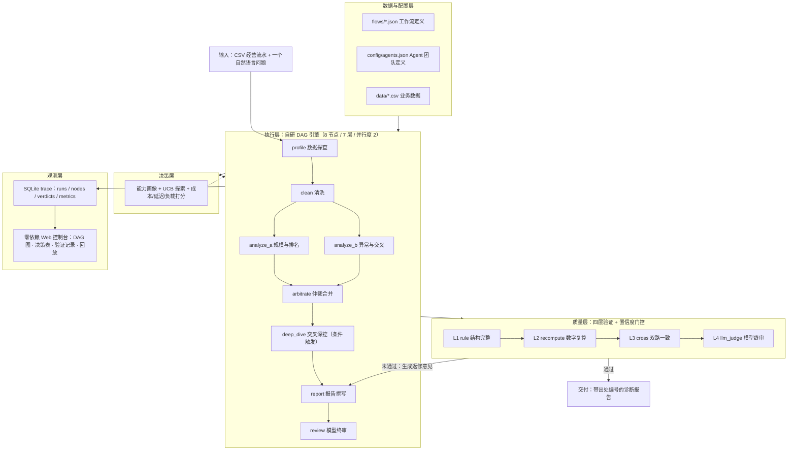

# 数诊编排 DataDx · 项目白皮书

> 参赛赛题：赛题一（Agent 编排创新应用）｜参赛队伍：阿巴阿巴｜参赛者：樊俊斌（湛江科技学院）｜参赛人数：1 人
> 版本：v1.0（2026-11-19）｜配套材料：技术方案书、方案讲解 PPT、演示视频、代码仓库

---

## 一、项目概述

### 1.1 背景与痛点

大模型应用正从"能对话"走向"能干事"。但在企业经营场景里，阻碍落地的往往不是模型不够聪明，而是三个更朴素的问题：

**痛点一：数据是脏的。** 中小企业从 ERP／进销存导出的订单流水常含缺失、负数、越界值。演示数据集中 240 行里有 5 行存在数量为空或单价为负，若不先清洗，总营收被负值拉低、客单价被空值抬高。

**痛点二：模型会编数字。** 若不加约束，大模型写报告时会做三类事：把 5,455,910.0 写成"约 546 万"、自行心算增长率、引用不存在的"行业平均"。这些数字在行文里毫无破绽。

**痛点三：错了没人知道。** 报告越专业越容易被信。某个区域营收错了 10%，管理层通常不会回原始表核对，错误因此从"分析问题"升级为"决策风险"。

现有工具的空白在于：聊天式大模型交付"一段文字"，BI 工具交付"一张图表"，而企业真正需要的是**一份敢拿去做决策、且能回溯每个数字出处的结论**。

### 1.2 应用范围与边界

**目标用户**：具备结构化经营数据（订单／销售流水）、但没有专职数据分析岗的中小企业与个体经营者；以及需要"可审计 AI 分析"能力的财税、代运营、ERP 服务商。

**典型场景**：区域与品类结构诊断、渠道效能评估、折扣策略效果评估、数据质量巡检。

**适用边界**（由验证机制决定）：凡结论可被**确定性复算**的场景均可迁移，例如合规审查、投标文件检查、财务对账；依赖主观判断的场景（品牌文案评价、战略取舍）不在本平台射程内。

**当前实现的边界（如实说明）**：
- 已实现：内置"经营数据诊断"一个场景；数据侧支持任意**同结构** CSV（`--dataset`）；更换业务场景需编写新的工作流配置，引擎不改。
- 未实现：网页端数据上传、多用户并发、权限体系、在线托管服务。

### 1.3 核心优势

| # | 优势（差异点） | 可验证依据 |
|---|---|---|
| 1 | **结论可证伪**：报告中每个绝对值都要回到事实表复算，容差 0.5%，对不上即打回重写 | 四层验证器；基准运行产生 13 条判定记录且全部留痕（rule 7／recompute 4／cross 1／llm_judge 1）；演练运行中错误值 `7,090,000` 被 recompute 捕获并触发返修 |
| 2 | **协作是真并行，不是流水线拼接**：两名分析师对同一份数据、以不同视角独立分析，再由仲裁员合并分歧 | 工作流共 8 节点、7 层依赖，第 2 层为双节点并行（`analyze_a`／`analyze_b`），第 3 层 `arbitrate` 汇聚；`cross` 验证器记录 `compared=['analyze_a','analyze_b'] agree=True` |
| 3 | **过程可回放、零依赖可复现**：每次运行的输入、输出、调度决策、验证证据、耗时与成本全量落库；核心不使用任何第三方库 | `runs.db` 保存既有运行；任意 `run_id` 可用 `python -m harness.cli replay <run_id>` 离线重放；无需 `pip install`、无 API Key 亦可完整演示 |

一句话定位：**本项目不是"更会写报告的大模型"，而是一套把 AI 输出纳入可审计流程的编排调度系统。**

---

## 二、解决方案

### 2.1 总体架构

平台自下而上分为五层。层与层之间通过配置文件与 SQLite 解耦，任一层可单独替换：

### 2.2 功能模块表

| 模块 | 解决什么问题 | 关键实现 | 状态 |
|---|---|---|---|
| Agent 团队定义 | 角色职责含糊、提示词散落代码 | `config/agents.json` 声明 8 个 Agent（主流程用 7 个，另 1 个通用型供基线评测），含提示词、工具集、模型档位、成本参数 | 已实现 |
| 工作流编排 | 流程写死、改动即改代码 | `flows/*.json` 描述节点、依赖、条件、验证器；引擎按依赖深度分层，同层并发 | 已实现 |
| 智能调度 | "派给谁"靠固定顺序，不可解释 | 能力画像（历史成功率）+ UCB 探索 + 成本／延迟／负载扣分，决策明细写入 trace | 已实现 |
| 工具集成 | 数字来源不可控 | `csv_profile`（确定性画像）、`sql_query`（内存 SQLite 真执行）、`python_eval`（受限求值，当前工作流未启用） | 已实现 |
| 结果验证 | 无法判断 AI 输出对错 | 四层验证 + 置信度门控（accept / repair / escalate） | 已实现 |
| 自我循环 | 失败即整条重跑，浪费且不收敛 | 节点内最多 3 轮返修；审校判否时**回溯到上游重写**（1 轮） | 已实现 |
| 执行监控与回放 | 出问题无法定位 | 四张表记录全链路；控制台可视化；`replay` 离线重放 | 已实现 |
| 数据接入 | 只能跑内置数据 | `--dataset`／`--question` 命令行参数覆盖默认配置 | 已实现 |
| 网页上传、多租户、权限 | — | — | **规划中** |
| MCP 生态接入、行业知识库 | — | 已在模型层与工具层预留扩展点 | **规划中** |
| 并发调度与压力测试 | — | — | **规划中** |

### 2.3 关键技术点

**技术点 1：自研 DAG 编排引擎（替代框架默认流水线）**

- **怎么做**：以 JSON 声明节点与依赖，引擎计算依赖深度分层，同层用线程池并发；节点内实现"执行—验证—修正"循环；支持 `when` 条件表达式与跨节点回溯。
- **为什么**：赛题技术要求明确"必须体现编排与调度的智能化，而非简单的硬编码流程""禁止直接套用现成框架的默认示例"。主流框架的默认用法恰是按顺序执行任务链，无法支撑调度算法与验证机制。
- **效果**：当前工作流为 8 节点、7 层、并行度 2；更换场景只需改 `flows/*.json`，引擎零改动（第二份数据集的运行验证了数据层解耦）。

**技术点 2：能力画像 + UCB 的调度打分**

- **怎么做**：对同角色候选 Agent，按
  `score = w₁·能力匹配 + w₂·UCB1(历史成功率) − w₃·归一化成本 − w₄·归一化延迟 − w₅·负载`
  打分取最大；`w=(1.0, 1.2, 0.35, 0.35, 0.8)`，探索系数 `c=0.30`。
- **为什么**：纯按成功率排序会让新 Agent 因样本为零被永久冷落；纯轮询则无法体现能力差异。
- **效果**：决策可解释并落库，控制台可见形如「能力匹配 1.00 + UCB 1.212（历史成功率 100%，样本 9）− 成本项 − 延迟项 − 负载项；**领先 analyst-b 0.018 分**」的记录，即"两个候选中算出来的选择"。

**技术点 3：以"数字"为一等公民的四层验证**

- **怎么做**：运行开始时由确定性代码生成编号事实表 F1–F11（订单数、总营收、客单价、区域／品类营收、区域订单数与单均等），连同工具输出一并注入提示词；要求绝对值标注编号、派生值写出算式。验证分四层：`rule` 查结构与完整性；`recompute` 对 ≥1000 的数字逐个复算（容差 0.5%）；`cross` 比对两路独立结论；`llm_judge` 真实调用模型做业务级审校。
- **为什么**：仅靠提示词约束无法防止编造；LLM 自评又缺乏客观性。
- **效果**：基准运行的 13 条判定全部通过；演练运行中错误值 `7,090,000` 被 `recompute` 判定为缺失口径并触发返修，第二轮通过。

**技术点 4：返修与回溯——把失败变成可收敛的迭代**

- **怎么做**：验证未通过时，把结构化证据（缺哪个口径、哪些数字无出处、问题定位）回灌为返修指令；单节点最多 3 轮；若审校节点判否，则回到上游 `report` 重写一次再复审。
- **为什么**：简单重试只会消耗预算；让审校员反复判否而产出不变，是常见的设计错误。
- **效果**：故障演练中 report 节点第 1 轮判否、第 2 轮通过，总耗时 83.3 秒、无人工介入。

**技术点 5：面向复现的工程取舍**

- **怎么做**：核心零第三方依赖（仅标准库）；内置离线 mock 后端；trace 落库；提供 `replay` 命令。
- **为什么**：评审专家在陌生机器上复现，是"可复现性"这一项的实际含义；依赖越少，失败点越少。
- **效果**：`git clone` 后无需任何安装即可运行；无 API Key 也能完整演示；任意历史运行可离线重放。

### 2.4 与现有方案的对比

| 维度 | 聊天式大模型 | BI 分析工具 | 通用 Agent 框架默认用法 | 本项目 |
|---|---|---|---|---|
| 输出形态 | 一段文字 | 图表看板 | 一段流程输出 | 带出处编号的报告 + 全量过程记录 |
| 数字化依据 | 无 | 有 | 取决于实现 | 事实表 F1–F11 + 本次工具证据池 |
| 错误能否被发现 | 不能 | 人工核对 | 一般不能 | 四层验证自动拦截并返修 |
| 调度方式 | 无 | 无 | 串行或轮询 | 能力画像 + UCB 打分，可解释 |
| 可复现性 | 差（随机性） | 依赖环境 | 依赖框架与配置 | 零依赖 + trace + 回放 |
| 失败处理 | 重问一遍 | — | 整条重跑 | 节点返修 + 跨节点回溯 |

---

## 三、应用成效

### 3.1 应用情况总述

平台已完成 10 次以上端到端运行，覆盖三条验证路径：正常流程、故障演练、以及更换数据集。全部运行记录保存在本地 trace 库，可按 `run_id` 逐条重放。以下为三次代表性运行的真机数据（模型：DeepSeek `deepseek-chat`）：

| 运行 | 场景 | 调用次数 | tokens | 成本 | 耗时 | 结果 |
|---|---|---|---|---|---|---|
| `…da7e` | 基准运行（240 行数据） | 8 | 58,210 | ¥0.1967 | 90.8 秒 | 13/13 验证通过，零返修 |
| `…fe9d` | 故障演练（报告首轮被截断） | 9 | 59,496 | ¥0.1852 | 83.3 秒 | 返修 1 次后通过 |
| `…2f56` | 第二份数据集（120 行） | 7 | 29,160 | ¥0.0992 | — | 通过 |

> 成本口径：按平台内置单价参数估算，真实扣费以模型服务商账单为准；三个数字均来自同一次运行的总账，非估算区间。

### 3.2 案例一：一次干净的全流程（`…da7e`）

- **背景**：240 行经营流水，含 5 行脏数据；问题为"各区域营收结构与结构性异常"。
- **痛点**：若直接交大模型，清洗、口径、出处均不可控。
- **方案**：8 节点全流程，双分析师并行，仲裁合并，四层验证。
- **过程**：8 次模型调用、90.8 秒；8 个节点全部第一轮通过；验证记录 13 条全通过。
- **量化结果**：tokens 58,210、成本 ¥0.1967；报告中的总营收、客单价、区域单均等数字均带 F 编号，可回指事实表。

### 3.3 案例二：系统自己发现并修复错误（`…fe9d`）

- **背景**：为验证容错链路，人为注入"报告首次输出被截断"的环境级故障（`max_tokens` 压至 120）。
- **痛点**：真实生产中的故障多为环境性（超时、截断），而非模型故意答错；若容错只覆盖模型错误，则覆盖不足。
- **方案**：故障注入 → 规则层判定"正文疑似被截断" → 结构化返修意见回灌 → 重写。
- **过程**：`report` 第 1 轮 `rule✗`（完整性）、第 2 轮 `rule✓ recompute✓`；总调用 9 次。
- **量化结果**：返修使总耗时由 90.8 秒（基准）变为 83.3 秒（本次数据规模相同、输出更短），全程零人工介入。

### 3.4 案例三：换一份数据，结论随之改变（`…2f56`）

- **背景**：另建 120 行、结构相同但数字完全不同的数据集（3 个区域、2 个品类）。
- **痛点**：若系统只对内置数据有效，则"平台"退化为"脚本"。
- **方案**：`python -m harness.cli run --dataset data/demo_second.csv --question "…"`，代码零改动。
- **过程**：7 次调用、29,160 tokens、¥0.0992，跑通并验证通过。
- **量化结果**：结论由原数据的"西南领先"变为"华北最赚钱、华南结构短板"，说明平台与具体数据解耦。

### 3.5 阶段性说明（如实披露）

当前处于**技术验证阶段**：无付费客户，无第三方出具的应用证明，未获任何奖项。已完成的是：完整跑通、量化性能数据、可复现的公开代码仓库与运行记录。本文不将技术验证表述为商业落地。

---

## 四、商业模式

### 4.1 推广模式与定价

| 模式 | 内容 | 定价思路（示例，非最终报价） | 适用客户 | 状态 |
|---|---|---|---|---|
| 按次计费 | 上传数据、付费出报告 | 单次 20 元级（模型成本约 0.2 元/次，主要成本为服务与算力） | 小微企业 | 设想 |
| 订阅制 | 固定周期自动出报告，含历史对比 | 按月订阅，含固定次数 | 成长型企业 | 设想 |
| 私有化部署 | 内网部署，数据不出域 | 按年授权 + 实施费 | 数据敏感型中大型企业 | 设想 |
| 教学与实训 | 作为 AI 工程化教学平台 | 按院校授权 | 高校、职业院校 | 设想 |

定价依据：单次运行的可变成本约 0.1–0.2 元（本文三次运行实测 0.0992–0.1967 元），因此定价空间主要取决于服务价值而非算力成本。

### 4.2 市场空间（TAM / SAM / SOM）

**计算方式（自下而上，便于替换为权威数据）**

- TAM（总体市场） = 有数字化经营数据的中小企业数 × 单客年可支付金额
- SAM（可服务市场） = TAM × 其中"有周期性经营分析需求且数据可导出"的比例
- SOM（可获得市场） = SAM × 平台在 3 年内可触达客户数 × 付费转化率

| 参数 | 取值 | 来源 |
|---|---|---|
| 全国中小企业数量（A） | **待核实** | 建议引用国家统计局／工信部口径 |
| 单客年可支付金额（B） | **待核实** | 建议以同类 SaaS／财税服务客单价调研替换 |
| 周期性分析需求比例（C） | **待核实** | 需目标客群调研 |
| 3 年可触达客户数（D） | **待核实** | 取决于销售与渠道建设 |
| 付费转化率（E） | **待核实** | 需试点数据 |

> 上述五项均需外部调研或统计口径，**本稿不填假设数值**，以免形成不可核验的市场结论。

**示例测算（仅演示算法，不作为结论）**：若 A=10 万家、B=1,200 元/年、C=30%、D=300 家、E=20%，则
TAM = 10 万 × 1,200 = 1.2 亿元；SAM = 1.2 亿 × 30% = 3,600 万元；SOM = 300 家 × 1,200 元 × 20% = 7.2 万元/年。

**替代路径（可立即验证的小市场）**：以教学实训场景切入——单院校按 2 万元/年授权测算，10 所院校即 20 万元/年规模，且该路径不依赖销售团队，可由个人开发者独立交付。

### 4.3 生态运作

- **上游**：模型服务商（DeepSeek、通义千问等）与云平台。通过统一 `ModelProvider` 抽象层保持可替换，避免供应商锁定；换模型只改环境变量。
- **中游**：财税、代运营、ERP 厂商。将平台嵌入其现有服务流程作为增值模块，我方提供引擎与验证规则，对方提供客户与数据接口。
- **下游**：行业工作流模板库。将已验证的 `flows/*.json` 与验证规则沉淀为可复用模板，按行业授权。
- **开源**：核心实现可审计，工作流模板与验证规则可对外开放，降低客户评估成本并形成社区共建。

---

## 五、团队介绍

### 5.1 成员与分工

| 姓名 | 角色 | 背景 | 负责模块 |
|---|---|---|---|
| **樊俊斌**（GitHub：hai-feng666） | 队长／唯一成员 | 湛江科技学院 | 需求定义、架构设计、全部编码（12 模块）、模型接入与调优、测试与评测、文档与演示材料 |

**工作方式说明**：一人承担全链路，因此设计上选择可解释、可复现、依赖最少的实现路径，避免"看起来强大但讲不清楚"的方案；代价是并发与性能测试、以及工程规模上的扩展尚未展开。

### 5.2 团队优势

1. **完整链路掌握**：从角色定义、工具注册、编排调度，到结果验证与反馈循环，全部自研可解释，不存在"这块不是我写的"的盲区。
2. **工程纪律**：项目自第一天即建立 trace、单元测试（12 项）、版本管理与回放机制；调试期记录并修复 9 个缺陷，每个都能定位到具体现象与修改依据。
3. **边界意识**：坚持"需稳定复现的环节一律用确定性代码"，不把判定权交给模型；对外只陈述已验证的内容。

### 5.3 外部支持

- 指导教师：无（个人参赛，赛事规则允许 0 名）
- 合作单位、算力赞助、企业导师：**暂无**
- 已使用的外部资源：DeepSeek 开放平台 API（自费，累计测试成本约 2 元）

---

## 六、附录：需准备的证明材料清单

| # | 材料名称 | 证明什么 | 获取渠道 | 是否已有 |
|---|---|---|---|---|
| 1 | 学生证／在读证明扫描件 | 参赛者学生身份（通知要求"学生身份证明资料"） | 学校教务系统／学生处 | **待准备** |
| 2 | 身份证正反面扫描件 | 参赛者实名信息 | 本人 | **待准备** |
| 3 | 报名成功截图 | 已完成官网报名 | omniedu.com 报名页 | **待补充**（如已截图则归档） |
| 4 | 代码仓库公开链接 | 作品可复现 | 已上传：https://github.com/hai-feng666/futurecup | **已有** |
| 5 | 运行记录导出（`runs.db` 截图或 replay 输出） | 真实运行可回放 | 本地 `python -m harness.cli replay <run_id>` | **已有** |
| 6 | 单元测试通过截图 | 工程可靠性 | 本地 `python -m unittest discover -s tests` | **待补充** |
| 7 | 演示视频（3–5 分钟） | 功能与效果直观展示 | 自行录制（脚本见 docs/视频脚本.md） | **待准备** |
| 8 | 应用推广证明（客户／合作方） | 商业落地 | — | **暂无**（不伪造，按"已验证／有明确路径"口径陈述） |
| 9 | 知识产权（软著／专利） | 原创性 | 中国版权保护中心（软著登记约 1–2 个月） | **暂无** |

---

## 附：① 还缺哪些关键信息（按重要性排序）

1. **演示视频（3–5 分钟）** —— 赛事必交项，目前完全未录制；无此项材料不完整。
2. **学生证／身份证扫描件** —— 通知明确要求"学生身份证明资料"，属资格材料，缺失可能导致材料不完整。
3. **TAM/SAM/SOM 所需的权威口径数据**（中小企业数量、单客付费、需求比例） —— 当前仅给出计算方式与示例，未填真实取值。
4. **口径统一确认** —— 技术方案书写"约 2,100 行代码"，实测 12 个模块共 **2,265 行**；建议两份材料统一为"约 2,300 行"，避免同一指标两个值。

## 附：② 评委最可能质疑的 3 个点及应答要点

**质疑 1：这套东西和直接用 ChatGPT 写报告有什么本质区别？**

应答要点：
- 区别不在"写"，在"验"。报告里每个 ≥1000 的数字都要回到事实表复算（容差 0.5%），对不上就打回重写，最多 3 轮——这一点可以现场演示：注入一次故障，看系统自己发现并修好。
- 此外调度是算出来的：控制台能看到"两个候选人、领先 0.018 分"的决策明细，不是按顺序取第一个。
- 依据：基准运行 13 条验证记录全留痕；演练运行中错误值 `7,090,000` 被捕获。

**质疑 2：只有一个人、只跑过一个场景，凭什么叫"平台"而不是"脚本"？**

应答要点：
- 判据是"换场景要不要改引擎"。当前 8 节点工作流由 JSON 描述，换业务场景只改 `flows/*.json` 与 `config/agents.json`，引擎、调度器、验证层不动。
- 已用第二份数据集（120 行、数字完全不同）验证数据层解耦：代码零改动，结论随数据变化。
- 也要如实承认边界：目前只内置一个场景、未做并发压测，这是团队规模带来的限制，不是设计缺失。

**质疑 3：验证机制本身靠谱吗？会不会"验证器自己错了还一本正经"？**

应答要点：
- 验证分四层，其中 L2（复算）与 L3（交叉）是**确定性代码**，不依赖模型判断；只有 L4（终审）调用模型，且其结论只作为一票。
- 权重上复算层最高（3.0），并设置信度门控：低于 0.30 直接转人工，不再重试。
- 调试期确实出现过误判（如中文"不通过"被解析为通过、年份 2026 被当业务数字），均已修复并留下了回归样本；这条演进线本身就说明验证器是被验证过的。
